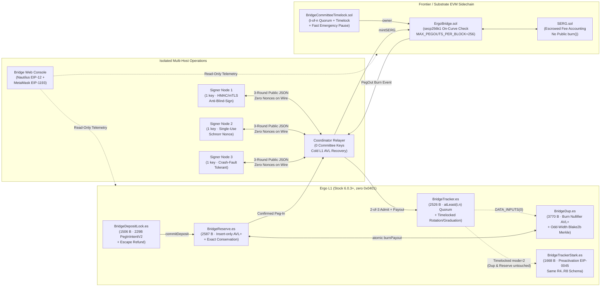

# Ergo ↔ Frontier Sidechain Bridge

[](https://github.com/a-shannon/ergo-sidechain-bridge/actions/workflows/v1-bridge-checks.yml)
[](https://github.com/a-shannon/ergo-sidechain-bridge/releases)

Clean, internally reviewed, **stock-Ergo-6.0.3-compatible** Ergo L1 ↔ Frontier/Substrate EVM sidechain bridge with on-chain AVL+ solvency & replay enforcement, distributed `t`-of-`n` multi-host Schnorr signing, timelocked EVM & Ergo governance, and a built-in **EIP-0045 RISC Zero 3.1.0+ STARK graduation seam** *(external third-party audit pending before mainnet)*.

All active V1 contracts, Solidity artifacts, multi-host signer daemon, relayer, CLI, Web Console, tests, and Docker stack live in [`v1/`](v1/).

---

## Architecture Overview



---

## Contract Inventory & Verification

### ErgoScript Contracts (`v1/contracts/`) — SigmaState 6.0.2 JVM Verified

All contracts stay well below Ergo's 4095-byte box script limit, emit **zero `0x0401` preactivation opcodes**, and enforce per-transaction cost **`<= 1,000,000`**:

| Contract | Compiled Size | Key On-Chain Invariants |
| :--- | ---: | :--- |
| [`BridgeDepositLock.es`](v1/contracts/BridgeDepositLock.es) | **1506 B** | Validates 229-byte `PegInIntentV2`, minimum deposit floor, and permissionless escape-hatch refund after `escapeTimeoutBlocks` |
| [`BridgeReserve.es`](v1/contracts/BridgeReserve.es) | **2587 B** | Pooled ERG vault with insert-only `SAvlTree`, exact liability/buffer conservation, and permissionless `rentRefresh` |
| [`BridgeDup.es`](v1/contracts/BridgeDup.es) | **3770 B** | Double-spend nullifier (`SAvlTree`), odd-width Blake2b-256 Merkle proof verifier, `BridgeTracker` `DATA_INPUTS(0)` binding, and `rentRefresh` |
| [`BridgeTracker.es`](v1/contracts/BridgeTracker.es) | **2526 B** | Federated `atLeast(t, n)` checkpoint admission (`370 B` `TrackerValueV1`), strict height monotonicity, `maxAdmissionLag`, timelocked `proposeUpgrade` / `cancelUpgrade` / `executeUpgrade`, and guarded `rentRefresh` |
| [`BridgeTrackerStark.es`](v1/contracts/BridgeTrackerStark.es) | **1668 B** | Preactivation **EIP-0045** RISC Zero 3.1.0+ graduation target preserving `R4..R8` so `BridgeDup` and `BridgeReserve` never redeploy |

### Solidity Contracts (`v1/solidity/`) — Deterministic `solc 0.8.35` Closure

| Contract | Key Hardening Properties |
| :--- | :--- |
| [`SERG.sol`](v1/solidity/SERG.sol) | Bridge-controlled `mint`/`bridgeBurn`, `renounceOwnership()` disabled, public `burn()` removed to prevent supply/reserve desynchronization |
| [`ErgoBridge.sol`](v1/solidity/ErgoBridge.sol) | On-curve `secp256k1` validation via EIP-198 `0x05` modexp + `returndatasize() == 32`, `MAX_PEGOUTS_PER_BLOCK = 256`, on-chain `processedPegIns` anti-amnesia deduplication, escrowed fee accounting, `renounceOwnership()` disabled |
| [`BridgeCommitteeTimelock.sol`](v1/solidity/BridgeCommitteeTimelock.sol) | On-chain `t`-of-`n` multisig + mandatory execution timelock owner for `ErgoBridge.sol`, separating delegated hot `relayMintSERG` & zero-delay `emergencyPause` from timelocked `withdrawFees` / `unpause` / `transferOwnership` / `setMintOperator` + quorum cancel |

---

## Verify Live Public Ergo Testnet Deployment (Zero Keys Required)

Bridge V1 has completed a full live deployment and peg-in → mint → burn → 2-of-3 committee admit → peg-out → cold L1 AVL reconstruction cycle on **public Ergo Testnet** (blocks `669454`–`669470`). See [`v1/docs/testnet-proof.md`](v1/docs/testnet-proof.md) for every confirmed `txId`.

Verify the live Testnet singletons and AVL+ roots directly from your machine:

```bash
# 1. Build the Rust WASM AVL+ prover & fetch SigmaState 6.0.2 JVM JARs
cd wasm-avl && wasm-pack build --target nodejs --out-dir pkg && cd ..
mvn -B -f v1/jvm/pom.xml dependency:copy-dependencies -DoutputDirectory="$(pwd)/v1/jvm/target/dependency"

# 2. Install & run the complete test suite (SigmaState 6.0.2 JVM + multi-host ceremony + Web API)
cd v1 && npm ci && npm run build && npm test

# 3. Inspect our live public Ergo Testnet deployment & reconstruct all 3 AVL+ trees from L1 history
npm run status:testnet
npm run reconstruct:testnet

# 4. Launch the interactive Bridge Web Console (Nautilus EIP-12 + MetaMask EIP-1193)
npm run ui:testnet
# -> open http://127.0.0.1:3000
```

---

## Multi-Host Committee Ceremony & Docker Stack

In production, committee keys **never** live on the coordinator host. Each committee operator runs an isolated `signer-node` holding **only its own key**:

- **Authentication**: HMAC-SHA256 signed requests with clock-skew window, request-nonce anti-replay cache, and mutual TLS (`npm run gen:mtls`, `BRIDGE_SIGNER_TLS_KEY` / `CERT` / `CA`) with a dedicated loopback-only `--health-port` for `/health` and Prometheus `/metrics`.
- **Anti-Blind-Signing Policy**: Every signer independently inspects `INPUTS(0)` / `OUTPUTS(0)` NFTs, `familyId`, `sidechainId`, monotonic `sourceHeight`, `BridgeTracker` ErgoTree preservation, WASM AVL proofs, and its own Frontier EVM RPC burn Merkle root before signing.
- **Single-Use Schnorr Nonce Defense**: Round-1 private commitments are consumed and purged from RAM immediately prior to Round-2 signing; replaying a session fails closed with `409 Conflict`, and zero `cmtWithSecret` / `"secret"` fields ever cross the wire.
- **Observability & Audit Readiness**: Prometheus `/metrics` on both `web-ui` and `signer-node`, alert rules in [`v1/ops/prometheus-alerts.yml`](v1/ops/prometheus-alerts.yml), multi-operator runbook in [`v1/docs/operator-runbook.md`](v1/docs/operator-runbook.md), external security audit package in [`v1/docs/audit-package.md`](v1/docs/audit-package.md) (`npm run audit:verify`), and responsible disclosure policy in [`SECURITY.md`](SECURITY.md).

See [`v1/docker-compose.yml`](v1/docker-compose.yml) for a ready-to-run 3-signer + coordinator + Web Console stack and [`v1/README.md`](v1/README.md) for full CLI usage (`status`, `reconstruct`, `ui`, `signer-node`, `deposit`, `refund`, `pegout`, `daemon`, `rent-refresh`, `propose-rotate`, `propose-graduate-stark`, `cancel-upgrade`, `execute-upgrade`).

---

## Trust Model & Scope Boundaries

- **V1 operates under an explicitly federated `t`-of-`n` committee trust model** on Ergo L1 (`BridgeTracker.es`) and `BridgeCommitteeTimelock.sol` quorum governance on Frontier EVM. Solvency conservation, deposit/payout accounting, double-spend nullification, confirmation windows, storage-rent liveness, and upgrade timelocks are enforced on-chain; sidechain checkpoint truth in V1 rests on the active committee quorum.
- **`BridgeTrackerStark.es` is a preactivation graduation seam** targeting **EIP-0045** RISC Zero 3.1.0+ support on Ergo. It is not yet active on stock Ergo 6.0.3 networks; once EIP-0045 activates, an active V1 deployment graduates via the built-in timelocked governance branch without touching `BridgeReserve` or `BridgeDup`.
- **Mainnet Prerequisites**: Independent multi-host signer isolation (mTLS + HSM/key custody), `BridgeCommitteeTimelock` (or Safe+Timelock) owning `ErgoBridge.sol`, and an external third-party security audit before handling mainnet funds.

---

## Repository Layout

- **`v1/`** — Active, self-contained **Bridge V1** release (ErgoScript, Solidity, JVM verifier harness, multi-host signer server/client, relayer daemon, CLI, Web Console, tests, Docker stack, and Testnet proof).
- **`wasm-avl/`** — Shared Rust `ergo-avltree-rust` WASM proof generator used by V1.
- **`.github/workflows/v1-bridge-checks.yml`** — Active Ubuntu Linux CI (`V1 Solidity closure & audit` + `V1 WASM AVL + SigmaState 6.0.2 JVM matrix + TypeScript`).
- **Legacy Research Archive** (`contracts/`, `relayer/`, `solidity/`, `docs/`, `sources/`) — Historical pre-V1 research artifacts retained untouched for provenance.
