# Ergo ↔ Frontier Sidechain Bridge — V1 Architecture & EIP-0045 Graduation Guide

## 1. Executive Summary & Design Goals

Bridge V1 is a clean, self-contained, stock-Ergo-compatible bridge between **Ergo L1** (native ERG) and a **Substrate/Frontier EVM sidechain** (`sERG`, 9 decimals = 1 nanoERG).

V1 resolves five structural limitations of earlier prototypes:

1. **Stock Ergo 6.0.3 Compatibility (Zero Node Patches)**: Requires **no** `0x0401` Ergo header extension commitment and no patched miner. Runs natively on stock Ergo devnet, public Ergo Testnet, and Ergo Mainnet (`treeVersion = 0`, `scriptVersion = 3`).
2. **Storage-Rent Safe Singletons**: All three protocol singletons (`BridgeReserve`, `BridgeDup`, `BridgeTracker`) expose a **permissionless `rentRefresh` branch** supporting optional ERG top-ups (`successor.value >= SELF.value`), preventing storage-rent eviction after 4 years (~1,051,200 blocks).
3. **Flexible Fee Funding**: Every transaction branch accepts an external pure-ERG fee input with an **optional non-protocol pure-ERG change output**, eliminating exact-UTXO pre-splitting traps while blocking deposit/protocol box rediscovery.
4. **On-Chain Timelocked Governance & Irreversible EIP-0045 Graduation**: `BridgeTracker` supports committee-signed, publicly visible timelocked proposals for:
   - `mode = 1`: **Committee rotation** (Epoch `N` → Epoch `N + 1`, new `atLeast(t, n)` script hash)
   - `mode = 2`: **Irreversible graduation to `BridgeTrackerStark`** (EIP-0045 native `verifyStark` on RISC Zero 3.1.0+)
   Both transitions preserve the complete `R5` AVL tree and require **zero changes or TVL migration** on `BridgeReserve` or `BridgeDup`.
5. **100% Stateless Chain Reconstruction**: SQLite (`v1/src/state/db.ts`) is strictly a rebuildable cache. After a crash or total database wipe, `reconstructFromErgoNode()` walks the exact `spentTransactionId` chains of the three singleton NFTs on a stock Ergo node (`extraIndex = true`), replays every AVL insertion, and verifies 33-byte digest equality against live on-chain `R5` registers before resuming.

---

## 2. Explicit Trust Model & Claim Boundaries

| Surface | V1 Security Model | Trustless Upgrade Path |
|---|---|---|
| **Peg-Out (Frontier → Ergo L1)** | **Federated `atLeast(t, n)` committee** on `BridgeTracker` (true distributed multi-party Sigma hints signing; no single wallet holds >1 committee key). Enforced on-chain by Ergo consensus. | Timelocked `mode = 2` graduation to `BridgeTrackerStark.es` once **EIP-0045** activates (`verifyStark` opcode `0xB9`, RISC Zero 3.1.0+ verifier profile). **Irreversible**, zero TVL migration. |
| **Peg-In (Ergo L1 → Frontier)** | **Federated relayer/owner** calling `ErgoBridge.mintSERG()` after L1 confirmation depth of `BridgeReserve` commit. Protected against replay by on-chain `processedPegIns[ergoBoxId]` and refundable user escape (`BridgeDepositLock`, `escapeTimeout`). | Upgradeable on Frontier by replacing the owner with a verified Ergo SPV/NiPoPoW light client + AVL membership verifier against `BridgeReserve.R5`. |
| **Replay & Reserve Solvency** | **Enforced on-chain** by `BridgeReserve` + `BridgeDup` AVL+ trees (key=32B, insert-only) and exact value/liability conservation. | Unchanged across committee rotation and EIP-0045 graduation. |
| **EVM Recipient & Block Safety** | `ErgoBridge.pegOut()` enforces **exact on-curve `secp256k1` validation** (`y² ≡ x³ + 7 mod P` via EVM precompile `0x05` with `returndatasize == 32`), caps per-block peg-outs at **`MAX_PEGOUTS_PER_BLOCK = 256`** matching Ergo's 256-leaf Merkle bound, disables `renounceOwnership()` on both `ErgoBridge` and `SERG`, and omits public `SERG.burn()`. | Active immediately in V1. |

**Important**: V1 must always be described accurately as a **federated bridge with on-chain conservation, replay protection, and a live timelocked EIP-0045 graduation seam** — not as trustless before EIP-0045 activation and sidechain Ergo SPV verification.

---

## 3. Canonical Contract Family (`v1/contracts/`)

```mermaid
flowchart LR
  UserErgo["User (Ergo L1)"] -->|"1. Lock ERG + 229B Intent"| DepositLock["BridgeDepositLock.es"]
  DepositLock -->|"2a. Commit (permissionless < timeout)"| Reserve["BridgeReserve.es\n(reserveNftId, R5=Deposit AVL, R6=Liability)"]
  DepositLock -.->|"2b. Refund (permissionless >= timeout)"| UserErgo
  Reserve -->|"3. Confirmed Reserve Commit -> mintSERG"| EvmBridge["ErgoBridge.sol + SERG.sol\n(Frontier EVM)"]
  EvmBridge -->|"4. pegOut() burns net sERG + escrows fee"| Relayer["V1 Relayer + Distributed Committee\n(atLeast t-of-n Sigma Hints)"]
  Relayer -->|"5. admitCheckpoint (NO 0x0401)"| Tracker["BridgeTracker.es\n(trackerNftId, R5=370B AVL, R9=Gov)"]
  Tracker -.->|"Timelocked mode=2 (irreversible)"| Stark["BridgeTrackerStark.es\n(EIP-0045 verifyStark)"]
  Tracker -->|"6. DATA_INPUTS(0) after minConfirmations"| Dup["BridgeDup.es\n(dupNftId, R5=Spent Burn AVL)"]
  Reserve -->|"7. Atomic Reserve + DUP Payout"| UserErgo
  Dup -->|"7. Atomic Reserve + DUP Payout"| UserErgo
```



### 3.1 `BridgeDepositLock.es` (1,533 B)
- **Registers**: `R4: Coll[Byte]` (229-byte `PegInIntentV2`), `R5: Coll[Byte]` (depositor ErgoTree for refund).
- **Branches**:
  1. `commitToReserve` (permissionless while `HEIGHT < creationHeight + escapeTimeout`): atomically merges `SELF.value` into `BridgeReserve` (`OUTPUTS(0)`), checking `reserveNftId`, `familyId`, exact `+amount` value & liability preservation, and isolated fee + optional pure-ERG change (change script cannot match `BridgeDepositLock` or `BridgeReserve`).
  2. `refund` (permissionless once `HEIGHT >= creationHeight + escapeTimeout`): returns exact `SELF.value` to `SELF.R5` with `R4 == SELF.id` (even if `R4` intent bytes were malformed, preventing permanent user fund lock!).

### 3.2 `BridgeReserve.es` (2,556 B)
- **Singleton NFT**: `reserveNftId` (amount = 1).
- **Registers**: `R4: Coll[Byte]` (`familyId`), `R5: AvlTree` (32B `sourceBoxId` → 32B deposit commitment, insert-only), `R6: Long` (outstanding nanoERG liability, `0 <= R6 <= SELF.value`).
- **Branches** (mutually exclusive on `(dataInputs.size, INPUTS.size)`):
  1. `deposit` (`data=0, in=3`, `Var(0)=depositProof`): absorbs `BridgeDepositLock`, inserts deposit commitment into `R5`, increments `value` and `R6` equally (preserving reserve buffer `value - R6`).
  2. `payout` (`data=1, in=3`, 0 vars on Reserve): requires `INPUTS(1)` = exact `dupContractId` carrying `dupNftId`; decrements `value` and `R6` by `OUTPUTS(2).value`, preserves `R5` and reserve buffer `value - R6`.
  3. `rentRefresh` (`data=0, in=2`, permissionless): preserves script, NFT, `R4..R6`, allows ERG buffer top-up (`successor.value >= SELF.value`), refreshes `creationInfo._1`.

### 3.3 `BridgeDup.es` (3,719 B) — Agnostic to Federated vs EIP-0045 Tracker
- **Singleton NFT**: `dupNftId` (amount = 1).
- **Registers**: `R4: Coll[Byte]` (`familyId`), `R5: AvlTree` (32B `burnId` → 1B `0x01`, insert-only).
- **Critical EIP-0045 Seam**: Authenticates `DATA_INPUTS(0)` (`tracker`) by **`trackerNftId` + `R4 == familyId` + `R6 == sidechainId` + unified 370-byte AVL value (`authMode ∈ {1, 2}`)** — never hardcoding a single frozen tracker script hash.
- **Branches**:
  1. `payout` (`data=1, in=3`, `Vars 0..3` = `trackerKey`, `trackerGetProof`, `205B encodedLeaf`, `proofBundle`): verifies tracker membership, `HEIGHT - admissionHeight >= minConfirmations`, odd-width Blake2b Merkle inclusion (`1..=256` leaves), exact recipient hash & payout amount, reserve conservation, burn non-membership, and atomic DUP AVL insert.
  2. `rentRefresh` (`data=0, in=2`, 0 vars, permissionless): preserves script, NFT, `R4..R5`, allows ERG top-up, refreshes `creationInfo._1`.

### 3.4 `BridgeTracker.es` (2,505 B)
- **Singleton NFT**: `trackerNftId` (amount = 1).
- **Registers**: `R4` (`familyId`), `R5` (`AvlTree` 32B → 370B, insert-only), `R6` (`sidechainId`), `R7: Long` (`latestSourceHeight`), `R8: Int` (`lastAdmissionErgoHeight`), `R9: Coll[Byte]` (81-byte governance register: `epoch(8BE) || pendingMode(1B) || pendingTargetScriptHash(32B) || pendingActivatesAtHeight(8BE) || pendingTrustAnchorDigest(32B)`).
- **Branches** (mutually exclusive on `Var(0)` action bytes):
  1. `admitCheckpoint` (`len=174, tag=0x01`, `Var(1)=avlInsertProof`, `committeeAuth`): inserts unified 370-byte entry (`authMode=1`), sets `admissionHeight = successor.creationInfo._1` bounded to `[HEIGHT - maxAdmissionLag, HEIGHT]`, strictly advances `R7`.
  2. `proposeUpgrade` (`len=66, tag=0x02`, `committeeAuth`): schedules `mode=1` (rotate committee) or `mode=2` (graduate to `BridgeTrackerStark`) activating at `proposeHeight + upgradeTimelockBlocks` (requires `pendingMode == 0` so no silent overwrite).
  3. `cancelUpgrade` (`len=1, tag=0x03`, `committeeAuth`): clears pending proposal in `R9`.
  4. `executeUpgrade` (`len=1, tag=0x04`, **permissionless** once `HEIGHT >= pendingActivatesAtHeight`): moves `trackerNftId` to `pendingTargetScriptHash`, preserving `R4..R8` verbatim and setting `R9` to Epoch `N+1` (`mode=1`) or the 32-byte `approvedGrandpaTrustAnchorDigest` (`mode=2`).
  5. `rentRefresh` (`Var(0)` absent, **permissionless**): preserves `R4..R9` and `propositionBytes`, allows ERG top-up, refreshes `creationInfo._1`.

### 3.5 Unified 370-Byte Tracker AVL Value Schema (Shared by FED & STARK)

| Offset | Bytes | Field | Notes |
|---|---:|---|---|
| `0..30` | 30 | `trackerValueDomain` | ASCII `"E2S_BRIDGE_V1_TRACKER_VALUE_V1"` |
| `30..31` | 1 | `version` | `0x01` |
| `31..32` | 1 | `authMode` | `0x01` = Federated, `0x02` = EIP-0045 STARK |
| `32..64` | 32 | `familyId` | Immutable bridge family ID |
| `64..96` | 32 | `sidechainId` | Immutable Frontier sidechain ID |
| `96..104` | 8 | `sourceHeight` | Sidechain block height (`u64be`, strictly increasing) |
| `104..136` | 32 | `sourceBlockHash` | Finalized sidechain block hash |
| `136..168` | 32 | `executionBlockHash` | EVM execution block hash (bound in burn leaf) |
| `168..200` | 32 | `bridgeEventRoot` | Odd-width Blake2b Merkle root of block's `PegOut` leaves |
| `200..204` | 4 | `burnCount` | `1..=256` (`u32be`) |
| `204..236` | 32 | `statementId` | Blake2b-256 checkpoint statement digest |
| `236..244` | 8 | `admissionHeight` | Ergo L1 `successor.creationInfo._1` (`u64be`) |
| `244..252` | 8 | `authorityEpoch` | Committee epoch (`mode=1`) or `0` (`mode=2`) |
| `252..284` | 32 | `authorityDigest` | `ergoKeySetDigest` (`mode=1`) or `blake2b256(programId \|\| profileId)` (`mode=2`) |
| `284..316` | 32 | `trustAnchorDigest` | `zero32` (`mode=1`) or `approvedGrandpaTrustAnchorDigest` (`mode=2`) |
| `316..348` | 32 | `sourceNetworkId` | Ergo L1 network domain ID |
| `348..370` | 22 | `reservedZero22` | Must be 22 zero bytes |

---

## 4. Solvency Accounting Invariant

At every finalized state:

$$\text{totalSupply}(\text{sERG}) \le \text{BridgeReserve.R6} \le \text{BridgeReserve.value}$$

- Every Peg-In adds `amount` to `BridgeReserve.value`, `BridgeReserve.R6`, and `sERG.totalSupply` (reserve buffer `value - R6` stays constant).
- Every Peg-Out of `grossAmount = netAmount + 5_000_000` burns `netAmount` of `sERG`, escrows `5_000_000` `sERG` in `ErgoBridge` (supply drops by `netAmount`), and pays out `netAmount` nanoERG from `BridgeReserve` (`value` and `R6` drop by `netAmount`).
- `rentRefresh` top-ups increase `BridgeReserve.value` without changing `R6`, permanently strengthening the reserve buffer.
- If `totalSupply(sERG) > BridgeReserve.R6` is ever observed, `BridgeRelayerDaemon` halts minting and triggers `ErgoBridge.emergencyPause()`.

---

## 5. EIP-0045 Native STARK Graduation Path (RISC Zero 3.1.0+)

`v1/contracts/BridgeTrackerStark.es` targets the EIP-0045 4-child ABI:

```scala
verifyStark(proofChunks, payload, expectedProgramId, expectedProfileId)
```

- Raw seal: 222,668 bytes split into 4 chunks (`65535 / 65535 / 65535 / 26063`).
- `ErgoStatementV1` wire encoder is implemented in `v1/src/core/codecs.ts` (`encodeEip0045StatementV1`).
- Verifier profile target: RISC Zero `3.1.0+` (current candidate `profileId` `5649af920f3119ca06e8566d836d3c89de81af52ef3d140a0ad7012ca364d35c` — replace with the final mainnet-activated EIP-0045 `profileId` and compiled guest `programId`).

### Graduation Procedure (Zero Downtime, Zero TVL Movement)
1. Compile `BridgeTrackerStark.es` under ErgoTree v4 with the finalized `programId`, `profileId`, and existing `trackerNftId` / `familyId`.
2. Compute `starkContractId = blake2b256(starkErgoTreeBytes)` and the Substrate GRANDPA `approvedGrandpaTrustAnchorDigest`.
3. Committee runs `cli.ts propose-graduate-stark --config <cfg> --stark-contract-id <hash> --trust-anchor <digest>`.
4. During the public timelock window (`upgradeTimelockBlocks`, recommended `720` ≈ 24 hours on testnet/mainnet), users and monitors inspect `BridgeTracker.R9` on-chain.
5. Once `HEIGHT >= pendingActivatesAtHeight`, anyone runs `cli.ts execute-upgrade --config <cfg> --target-ergotree <starkErgoTreeHex>`.
6. `trackerNftId` moves irreversibly to `BridgeTrackerStark.es` with the entire historical `R5` AVL tree intact. `BridgeReserve` and `BridgeDup` continue settling both historical `authMode=1` and new `authMode=2` checkpoints without modification.

---

## 6. Public Ergo Testnet Deployment Runbook

1. Run a synced **stock Ergo 6.0.3 Testnet node** with `ergo.node.extraIndex = true` (no patches required).
2. Deploy `v1/solidity/compiled/SERG` and `v1/solidity/compiled/ErgoBridge` to your Frontier testnet and transfer `SERG` ownership to `ErgoBridge`.
3. Mint three singleton NFTs (`BridgeV1TrackerNFT`, `BridgeV1DupNFT`, `BridgeV1ReserveNFT`) using `buildMintSingletonNftTx` and confirm on Ergo Testnet.
4. Copy `v1/config.testnet.example.json` to `v1/config.testnet.json` and fill in the 3 NFT IDs, deployed EVM addresses, and committee compressed secp256k1 public keys (`minConfirmations: 15`, `maxAdmissionLagBlocks: 5`, `upgradeTimelockBlocks: 720`).
5. Compile the 4 contracts (`compileBridgeV1Family`) and broadcast the atomic Genesis transaction (`buildGenesisDeployTx`).
6. Verify live state with `npm run cli -- status --config config.testnet.json` and run a dry-run tick (`BRIDGE_BROADCAST_ENABLED=false`) before enabling live relay (`BRIDGE_BROADCAST_ENABLED=true`).
7. Keep signing keys isolated: in production, run each committee member on a separate host exchanging only public `TransactionHintsBag` commitments/hints — never co-locate `>= threshold` committee secrets on one machine.
